# P-KCA-001  (rev: 0)  -  P-KCA-001 Methods for Respect for the materials ( Core )-converted.pdf.pptx

**P-KCA-001#1  [slide]**  Description This visual help describes the cares for to assure the integrity of the insulates and CRGO Process objective To assure the integrity of the materials for the manufacture of theCore Scope Insulates and CRGO Tools and materials Racks for the materials Works tables Tools Members of the system: Core operators Instructors Process engineer Supervisor B.N/S.S

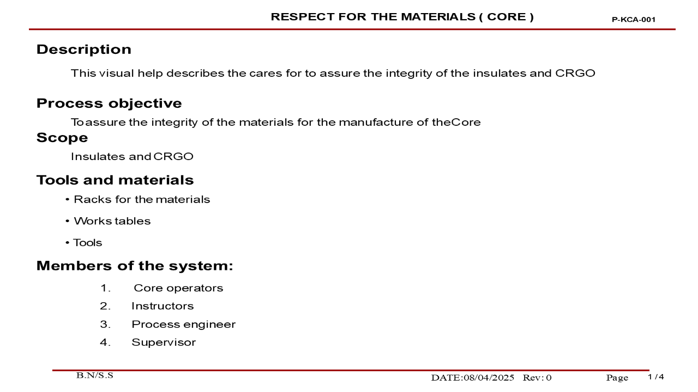

---
**P-KCA-001#2  [slide]**  Principal points ( avoid and assure ) for the integrity of the materials The insulates and CRGO Will never touch the floor & oven directly Will never be in contact with the metal or paint Will never be marked with common pen or commn pencil Will never be with damages Always must to be protect with plastic before to use during thestore Always must to cut with the correct tool Always need to avoid that the insulates and CRGO fall to the floor Always need to use the correct pallet for transportationof the CRGO B.N/S.S

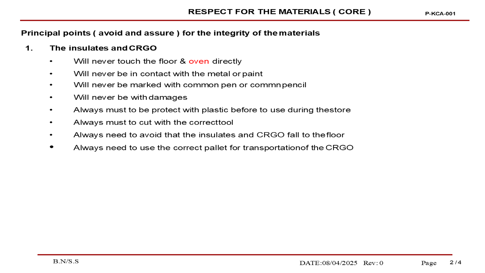

---
**P-KCA-001#3  [slide]**  Risks ? Insulates and CRGO Tools and platforms in bad conditions Rusty in the racks and tools Bad transportation from the other areas Bad use for the operators Not existence of the necesary accesories for the process ( pistons, platforms, etc ) Bad process for the manufacture Not protection in the racks How ? Insulates and CRGO To assure that all the CRGO supports will be protect with plastics or special insulate Protectedwith plastic all the parts that could be touch the materials To provide the correct tools for to mark, cut or move the materials To assure the good condition of the tools To avoid the rusty in the items into the area, to clean every days To assure the correct placement of the material into the core B.N/S.S

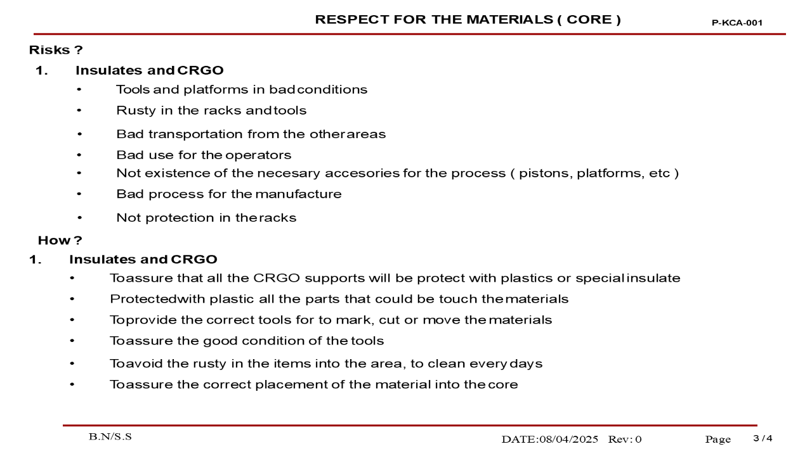

---
**P-KCA-001#4  [slide]**  Visual helps X B.N/S.S X X □ □

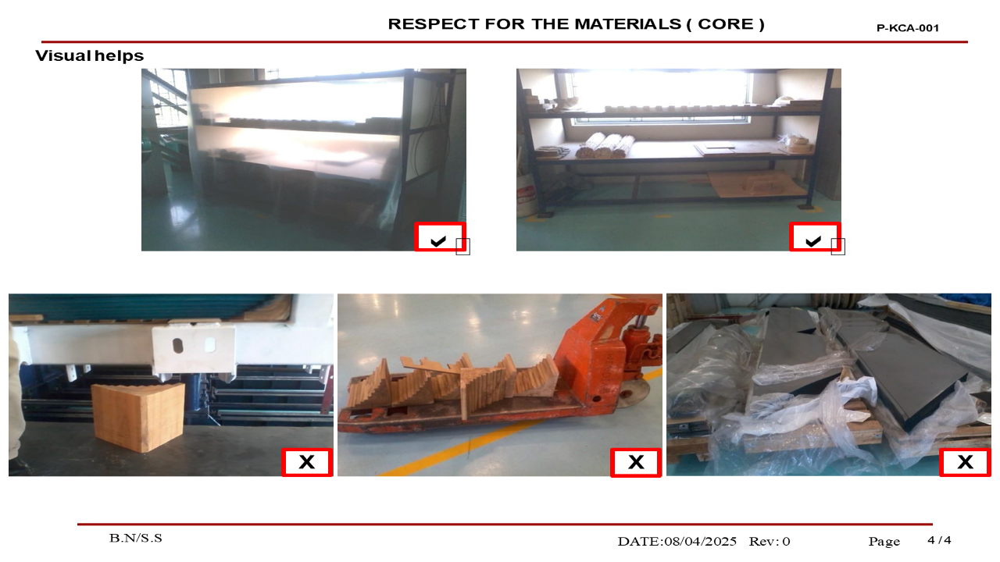

---

# P-KCA-002  (rev: 0)  -  P-KCA-002 Method for to check Quality for the  product ( Core ).ppt

**P-KCA-002#1  [slide]**  B.N/S.S Description This visual help describes the point that we need to consider for to assure a quality product Process objective To assure the quality of the products Scope Cores Tools and materials Racks for the materials Works tables Tools Platforms Members of the system: Core operators Instructors Process engineer Supervisor

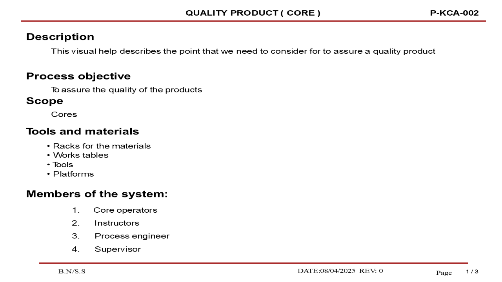

---
**P-KCA-002#2  [slide]**  B.N/S.S Without damages in the insulates and CRGO and Frames Without pollution ( dust, stains, metal, paint, etc ) Accomplish the dimensions and specs as information required Diameter Torch All the components correctly place Principal points ( avoid and assure ) for the integrity of the products 1. Core:

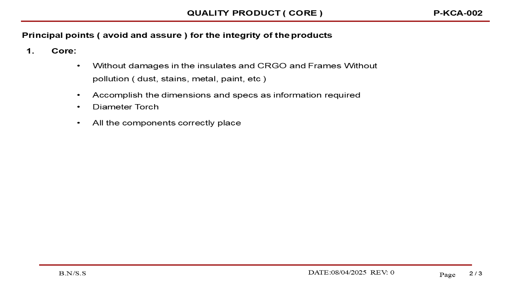

---
**P-KCA-002#3  [slide]**  Visual helps Free damages in the CRGO and the insulates Free damages in the frames, paint, not dirty, not pollution B.N/S.S

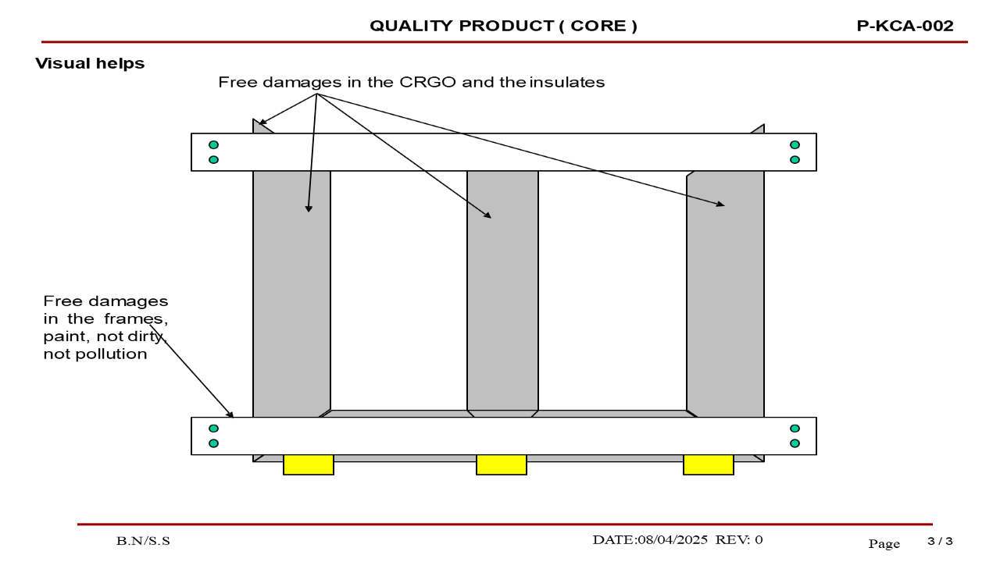

---

# P-KCA-003  (rev: 0)  -  P-KCA-003 Daily work routine.ppt

**P-KCA-003#1  [slide]**  Members of the system: Plant Manager Process Engineer Supervisor B.N/S.S 1 /2 Description This visual help describe the daily routine for the Supervisor during the entire shift Process objective To assure the accomplish of theplan Scope Core building supervisor Tools and materials N/A

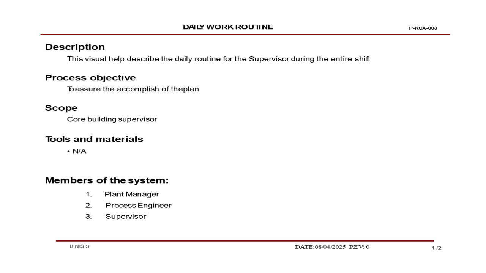

---
**P-KCA-003#2  [slide]**  Collect progress and hanging on every station to initiate the turn. Identify the CORE required for the subsequent process. Board at beginning of shift to all operators. Do a call roll. Issues that can be played on the board: Quality EHS Process. Etc. Assign staff to each station of work and indicate the OBJECTIVES of turn. Review and take actions for each point : ( Minimums 3 times per shift ) Correct Design information. Tool kit complete and in good condition. Core Inspection Checklist complete and fill. ( F-KCA-007 ). Production core graph complete and fill ( F-KCA-008 ). Been complied with routine cleaning and full document. ( F-KCA-001 )Updated all thickness record ( F-KCA-006) Review design information and materials of the next order. PPQA for assure the packing process.( F-KCA-003) Prepares weekly chart radar 5S s and discussed with operators. Prepares weekly quality graphics with the deviations of the Week and Discussed with operators Support to operators who are behind on the plan of production. Performs analysis of problems in the area, ( 5 Why s ) B.N/S.S 2 /2

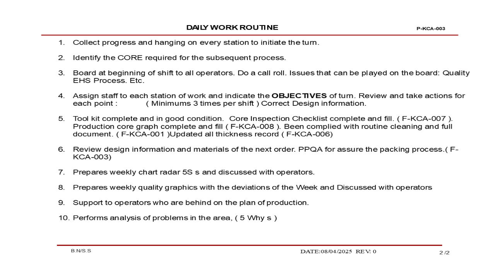

---

# P-KCA-004  (rev: 0)  -  P-KCA-004 Method for green polyester belt tightening.ppt

**P-KCA-004#1  [slide]**  Description: This method applies for tightening the phase limb by using polyester belt Process objective: To tight the phase limb with polyester belt by using tightening and clamping machine Scope: This method applies for tightening and clamping of 3 & 5 limb core by using polyester belt Tools & Materials: Tightening machine Clamping machine Glue Insulation wrap Members of the system: Operator Instructors Process engineer Core Supervisor B,N/S.S

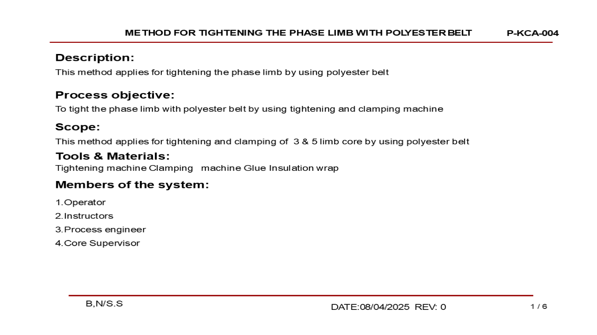

---
**P-KCA-004#2  [Step 1]**  1. First take the perimeter of core limb where polyester strip has to be tightened . 50mm width insulation 2. First wrap the 50 mm wide insulation and wrap over the perimeter of core limo and fix the extra part of insulation by gum. 3.Then place the polyester belt around the insulation wrap B,N/S.S

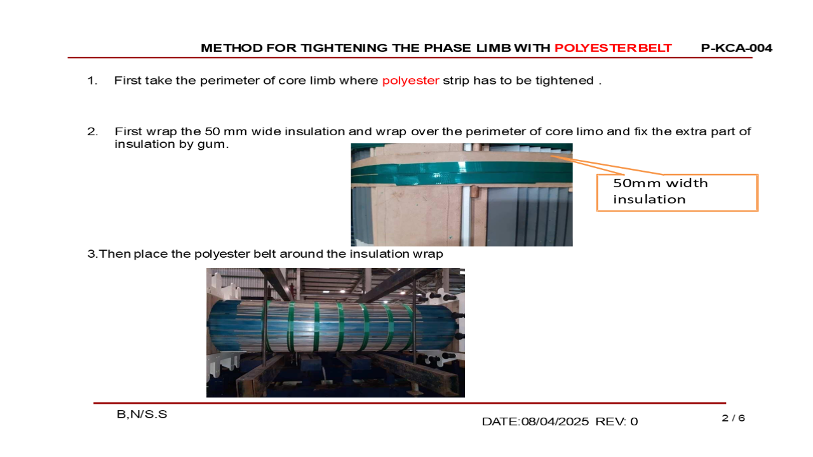

---
**P-KCA-004#3  [Step 4]**  4. Now place the polyester belt and tight it with tightening machine and keep hold it . Press the grey color button of machine and tight it. Joint & cut button Tighteningmachine 5. . After tightened the polyester strip, start the joint and cutting process of ployester Tight button B,N/S.S

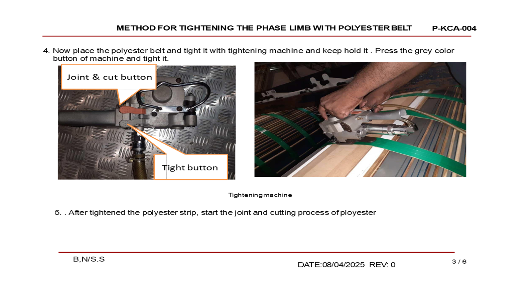

---
**P-KCA-004#4  [slide]**  B,N/S.S

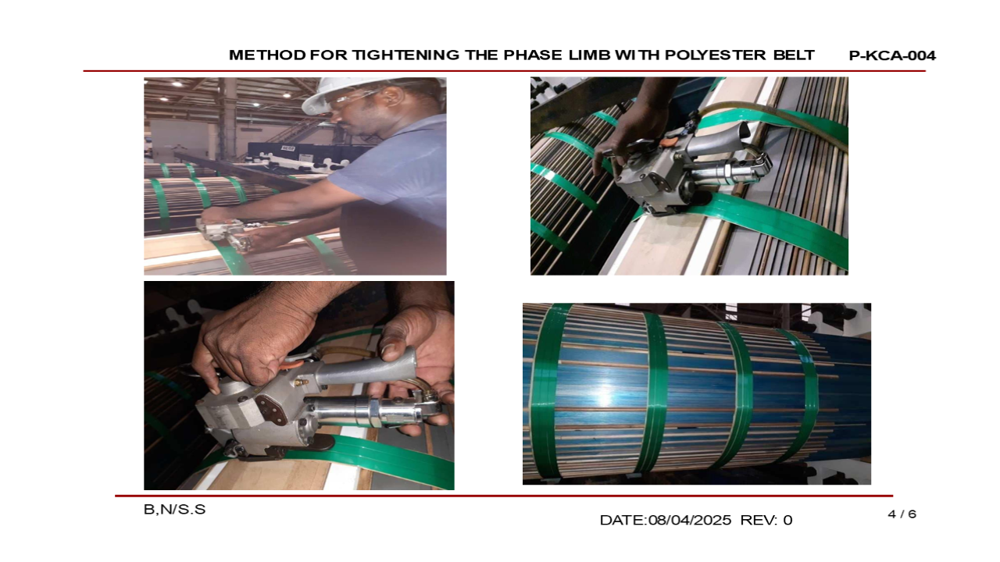

---
**P-KCA-004#5  [slide]**  B,N/S.S

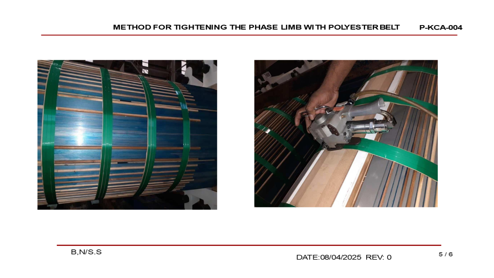

---
**P-KCA-004#6  [slide]**  6 . Press the orange colour button for joint & cut. 7. After cutting remove the polyester strip from machine B,N/S.S

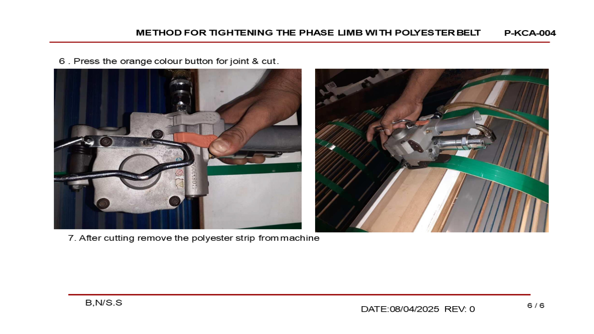

---

# P-KCA-005  (rev: 0)  -  P-KCA-005 Method of polyglass belt preparation and uses.ppt

**P-KCA-005#1  [slide]**  Description This method applies for Preparation and oses of polyglass tape in core boilding area Process objetive To tight both the side limb ( Lateral limb ) of 5 limb core Scope This method applies for tightening of side limb of 5 limbcore Tools & Materials Members of the system: Operator Instructors Process engineer Core Supervisor B.N/S.S 20 mill thickness x 50 mm width insulation paper Poly glass tape Allen key Pasting sticker Poly glass belt fixture

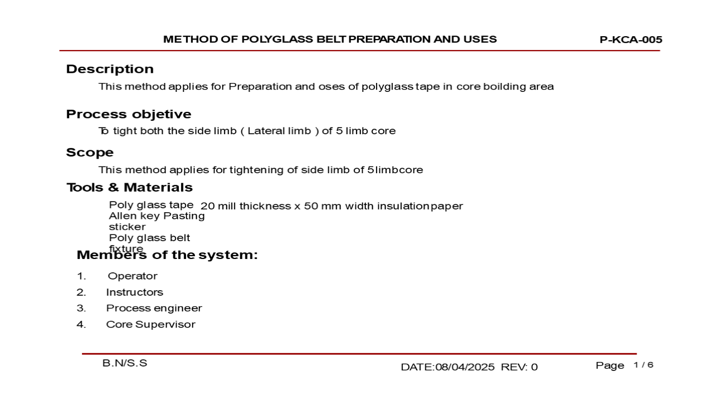

---
**P-KCA-005#2  [Step 1]**  1. Preparation of Roll:- Manually make a roll of a desired length. Then tie one end of roll to a corner/ any part of wood then measure the length of polyglass tape . This length should be equal to diameter of side limb then tie with another corner. B.N/S.S

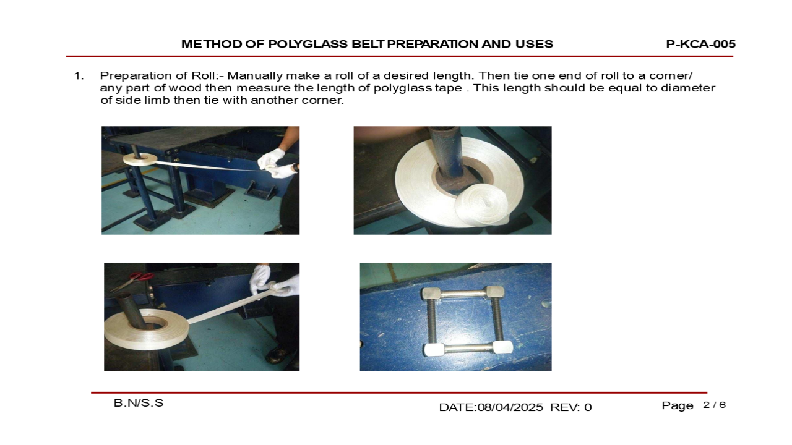

---
**P-KCA-005#3  [Step 2]**  2. Now tie the part of polyglass tape and measure the distance from one tied end and mark it as per design information. 150 mm distance as per design information B.N/S.S

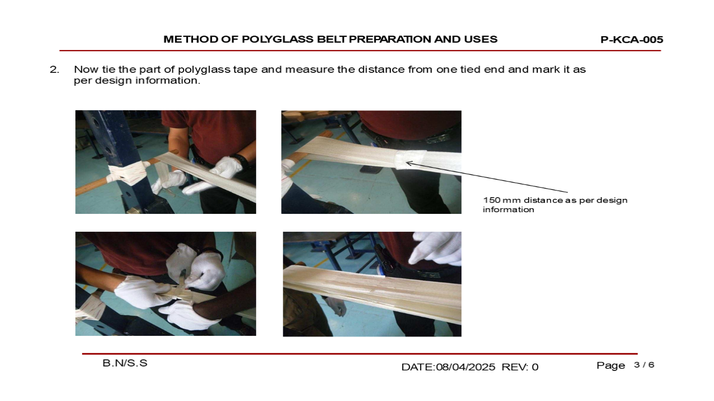

---
**P-KCA-005#4  [Step 3]**  3. Now make it stretch and place the insulation strip in between the polyglass tape. Now again start wrapping of polyglass tape around the insolation over polyglass tape. Tape it as per design information . B.N/S.S

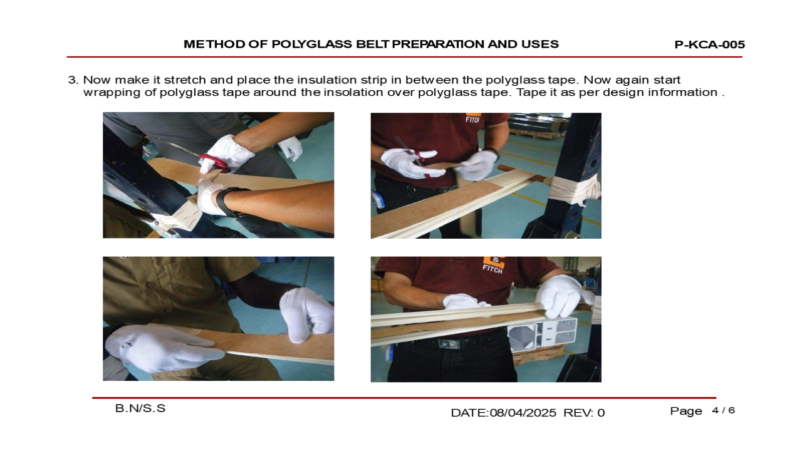

---
**P-KCA-005#5  [Step 4]**  4. Overlap should be 50 %. In the last end paste it with stickerand take foll belt and now place it on the insolation wrap on core sidelimb B.N/S.S

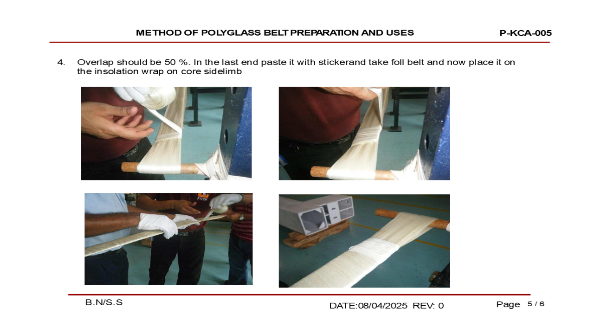

---
**P-KCA-005#6  [Step 5]**  5. Pass the belt throogh side limb and place it in nots and tight it with allen key. Take care polyglass fixtore always placed ooter part of side limb. B.N/S.S

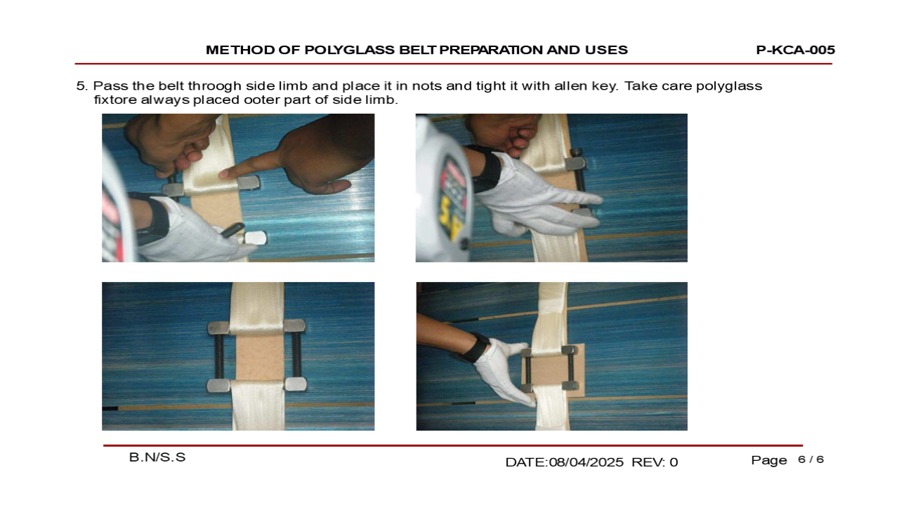

---

# WI-KCA-01  (rev: MISSING)  -  WI-KCA-01 WORK INSTRUCTION OF CORE ASSEMBLY_.docx

**WI-KCA-01#1  [text]**  OCP-WORK INSTRUCTION OF CORE ASSEMBLY SCOPE - This work instruction is based on working guidelines and instructions in core assembly area. For any working technique in core assembly workers, supervisor & others can refer to work Instruction. This instruction applies for core assembly. OBJECTIVE- The objective of this work instruction is to establish guidelines and criteria for core assembly. It gives safety instructions too. PREREQUISITES:

---
**WI-KCA-01#2  [text]**  PPEs: | SAFETY:

---
**WI-KCA-01#3  [text]**  Use all PPEs required for this stage Use correct tools Use Gloves

---
**WI-KCA-01#4  [text]**  Operational Condition | Environmental Impact | Control

---
**WI-KCA-01#5  [text]**  Temperature : Normal Monitoring : Nil Health Risk : Low | Land Contamination. Resource Depletion. | Ensure that the cotton waste, Gloves, MS Waste & Insulation Waste are disposed to respective bins. Non-Hazardous/ Hazardous waste disposal as per waste management procedure Ref: [COMPANY]-IMSP-36

---
**WI-KCA-01#6  [text]**  TOOLS: | MATERIALS:

---
**WI-KCA-01#7  [text]**  Mallets Measurement tape Vernier caliper Trisquare Spirit level Ring and double end spanners Cranes and slings Support channels Hole bar OD Caliper 2KV Meggar | Frame parts Core Lamination sheet Polyester tape &Clamp Step wood & Core stick Core insulation pad and flitch plate pad Core clamping bracket Bottom feet Hardwares

---
**WI-KCA-01#8  [text]**  PROCEDURE

---
**WI-KCA-01#9  [Step 1]**  Step 1: Study the specified drawing or specifications.. How: Read all information one by one.. Why: To do the core building as per specification/drawing.

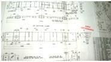

---
**WI-KCA-01#10  [text]**  [image only, no text]

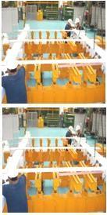

---
**WI-KCA-01#11  [Step 2]**  Step 2: In case of any doubt. How: Ask supervisor. Why: To clarify.

---
**WI-KCA-01#12  [Step 3]**  Step 3: Core Pad insulation drying. How: Place the core pad insulation in oven inside 12hrs. Why: To increase IR Value

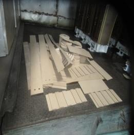

---
**WI-KCA-01#13  [Step 4]**  Step 4: Core building fixture setting. How: Set the core building fixture with specified leg centre / window height between axes.. Why: To get the specified leg centre / window height.

---
**WI-KCA-01#14  [Step 5]**  Step 5: Frame setting. How: Check the diagonals& Frame to Frame distance using measuring tape. Flitch plate seating For visual help Refer the Annexture-1. Why: To get square ness of frame setting.

---
**WI-KCA-01#15  [Step 6]**  Step 6: Frame setting. How: Check the horizontal level of frames with 1 meter spirit level & Check Base feet fouling in Core fixture Verify that the dimensions of frame as per design Information.. Why: To ensure the horizontal level.

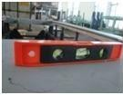

---
**WI-KCA-01#16  [Step 12]**  Step 12: Stack completion. How: After completing all the stacks check the core circumference & measure the total stack height with OD calipers and note down in the check list. Tolerance thickness should be ±2 mm.. Why: To ensure the core diameter. & circumference

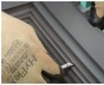

---
**WI-KCA-01#17  [Step 13]**  Step 13: Top insulation placing. How: Place core insulation and flitch plate insulation on top of the core in appropriate places. Validate the frames and flitch plate above the lower leveled. Hold lamination and insulation to prevent movement.. Why: To provide insulation.

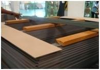

---
**WI-KCA-01#18  [Step 14]**  Step 14: Frame tightening & step wood gap. How: Provide all specified hardware, yoke studs and tie rods and tight them with spanners & fill step wood to core gap by wooden or PCB material. Why: To tight the core

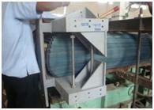

---
**WI-KCA-01#19  [Step 15]**  Step 15: Cross channel fixing. How: Fix the cross channels to the core and core fixture and tight them to hold the core intact while making it vertical. Why: To hold the core intact while making it vertical

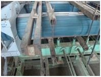

---
**WI-KCA-01#20  [Step 16]**  Step 16: Top yoke removal. How: After completion of all the stack start removing the lamination one be one. Keep the duct position same while removing the top yoke. Why: To make core vertical

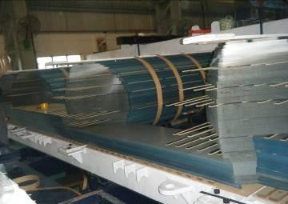

---
**WI-KCA-01#21  [Step 17]**  Step 17: Checking the hardware. How: Check for all cross channels, base feet packing yoke studs correctness and tightness of hardware.. Why: To ensure safe vertical

---
**WI-KCA-01#22  [Step 18]**  Step 18: Base step wood packing and apply glue on step wood gaps. How: Place the step wood in the base feet with appropriate sizes. If any gaps present between step wood and core, fill the gaps by wooden material and apply glue on it. Place the appropriate core stick to maintain the core diameter. Strap the core using 2225 polyester strap-19 mm width. Strapping belts will be maintained at every 150-200 mm gap for above 10MVA &below 10MVA glue applies the core using by dobefill.. Why: To keep it in position

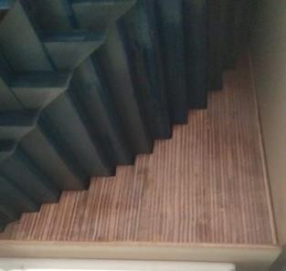

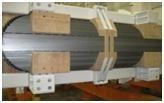

---
**WI-KCA-01#23  [Step 19]**  Step 19: Fix core upender. How: Fix the core upender with bottom support of fixture. Provide the wood packing between bottom feet and upender.. Why: To fix the upender.

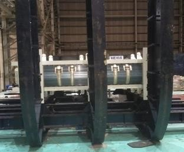

---
**WI-KCA-01#24  [Step 20]**  Step 20: 2.5 KV DC Test. How: Apply 2500volts to core & frame by meggar If isolation job apply 2500volts to frame to frame by meggar. Why: To identify any short in core to frame& frame to frame

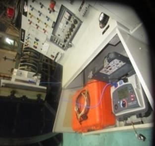

---
**WI-KCA-01#25  [Step 21]**  Step 21: Core vertical. How: Make the core vertical along with the fixture and core upender by using crane. Fix the support of fixture with proper hardware.. Why: To make vertical.

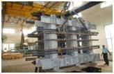

---
**WI-KCA-01#26  [Step 22]**  Step 22: Core lifting. How: Remove the fixture by engaging the crane directly on core and release all cross channels and extra supporting channels which are provided to provide core intact with the fixture and hoist the core and keep in the appropriate place.. Why: To disengage the core from the fixture.

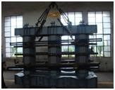

---
**WI-KCA-01#27  [Step 23]**  Step 23: Densified wood ring placing. How: Place the bottom densified - wood ring in three limbs with the height specified in drawing.. Why: For leveling base.

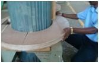

---
**WI-KCA-01#28  [Step 24]**  Step 24: Fill the check list. How: Fill up the check list F-KCA- 007 at appropriate stage, job card F- KJC-001. Why: To ensure the core assembly at each stage of process

---
**WI-KCA-01#29  [text]**  Records: F-KCA-007 Check list of core building F-KJC-001Job card P-KCA-001 Method of Respect for the materials (Core) P-KCA-002 Quality product (Core) P-KCA-003 Daily work routine P-KCA-004 Method for polyester belt tightening P-KCA-005 Method of poly glass belt preparation and uses

---
**WI-KCA-01#30  [text]**  Prepared by | Reviewed by | Approved by

---
**WI-KCA-01#31  [text]**  [NAME] Engineer-Operations | [NAME] Dy Manager - Operations | [NAME] Dy Manager - Quality | [NAME] Sr.Manager- Operations | [NAME] DGM- Quality

---
**WI-KCA-01#32  [text]**  [image only, no text]

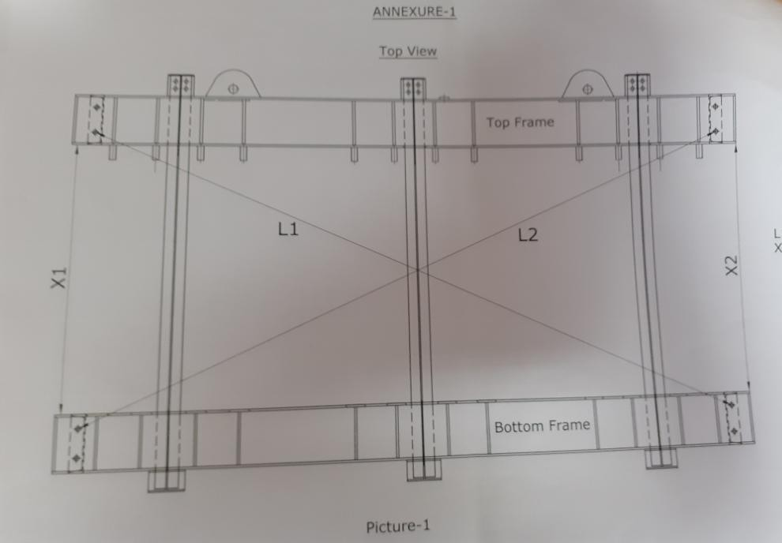

---

# WI-KCA-02  (rev: MISSING)  -  WI-KCA-02 WORK INSTRUCTION FOR CORE BUILDING 5 LIMB.docx

**WI-KCA-02#1  [text]**  OCP-WORK INSTRUCTION OF 5 LIMB CORE ASSEMBLY SCOPE - This work instruction is based on working guidelines and instructions of 5limb core assembly areas. For any working technique in core assembly workers, supervisor & others can refer to work Instruction. This instruction applies for core assembly. OBJECTIVE- The objective of this work instruction is to establish guidelines and criteria for 5 limb core assembly. It gives safety instructions too. PREREQUISITES:

---
**WI-KCA-02#2  [text]**  PPEs: | SAFETY:

---
**WI-KCA-02#3  [text]**  Use all PPEs required forthisstage Use correcttools Use Gloves & armprotectionsleeve Handsleeves Apron

---
**WI-KCA-02#4  [text]**  Operational Condition | Environmental Impact | Control

---
**WI-KCA-02#5  [text]**  Temperature : Normal Monitoring : Nil Health Risk : Low | Land Contamination. Resource Depletion. | Ensure that the cotton waste, Core Gloves, MS Waste& Insulation Waste are disposed to respective bins. Non Hazardous/ Hazardous waste disposal as per waste management procedure Ref: [COMPANY]-IMSP-36

---
**WI-KCA-02#6  [text]**  TOOLS: | MATERIALS:

---
**WI-KCA-02#7  [text]**  Mallets Measurement tape Vernier caliper Trisquare Spirit level Ring and double end spanners Cranes and slings Support channels 2KV Meggar Thickness Gauge | Frame parts Core Lamination sheet Polyester tape Step wood Core insulation pad and flitch plate pad Core clamping bracket Bottom feet Core stick Polyglass tape

---
**WI-KCA-02#8  [text]**  PROCEDURE

---
**WI-KCA-02#9  [Step 1]**  Step 1: Specified drawing or specifications.. How: Read all Information’s one by one.. Why: To do the core building as per specification/drawing.

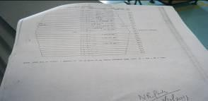

---
**WI-KCA-02#10  [text]**  OCP- WORK INSTRUCTION OF 5 LIMB CORE ASSEMBLY

---
**WI-KCA-02#11  [Step 2]**  Step 2: doubt. How: Ask supervisor. Why: To clarify.

---
**WI-KCA-02#12  [Step 3]**  Step 3: Core Pad insulation drying. How: Place the core pad insulation in oven inside 12hrs. Why: To increase IR Value

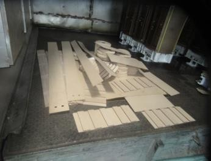

---
**WI-KCA-02#13  [Step 4]**  Step 4: Platform preparation of 5 limb core. How: Provide the support of lamination stand across the arm of core bed. Provide the gasket on the feet of support stand in order to avoid the damage of floor. Why: To start the fixture setting

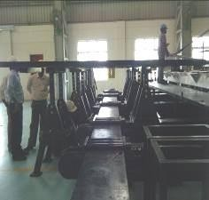

---
**WI-KCA-02#14  [Step 5]**  Step 5: Core building fixture setting. How: Set the core building fixture with specified leg center / window height between axes.. Why: To get the specified leg center / window height.

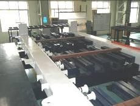

---
**WI-KCA-02#15  [Step 6]**  Step 6: Pallet arrangement of 5 limb core. How: Provide the pallet arrangement of 5 limb core as shown in Annexure – 2. Lift the pallet by using crane and nylon rope. Provide the extra support by metal channel to lift the pallet.. Why: To start the frame setting

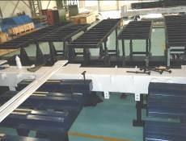

---
**WI-KCA-02#16  [text]**  OCP-WORK INSTRUCTION OF 5 LIMB CORE ASSEMBLY

---
**WI-KCA-02#17  [Step 7]**  Step 7: Frame setting. How: Check the diagonals & frame to frame distance using measuring tape. Flitch plate seating for visual help Refer Annexure-1. Why: To get squareness of frame setting.

---
**WI-KCA-02#18  [Step 8]**  Step 8: Frame setting. How: Check the horizontal level of frames with 1 meter spirit level & check base feet fouling in core fixture. Verify that the dimensions of frame as per design information.. Why: To ensure the horizontal level.

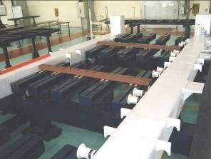

---
**WI-KCA-02#19  [Step 9]**  Step 9: Insulation placing. How: Place the insulation on frames and flitch plates as specified. Verify that the dimensions of insulation and flitch plate as per design information.. Why: To provide insulation between core and core frame.

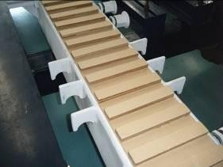

---
**WI-KCA-02#20  [Step 10]**  Step 10: Start the core building. How: Put the first layer of laminations and measure all dimensions.. Why: To ensure the dimensions.

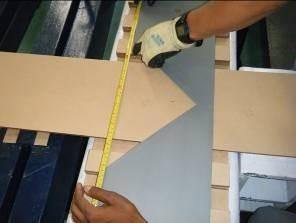

---
**WI-KCA-02#21  [Step 11]**  Step 11: Step wood placing. How: Put step wood in Lateral position. Why: To provide the support to core

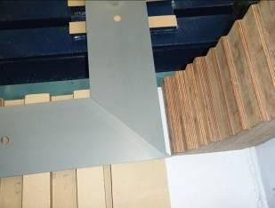

---
**WI-KCA-02#22  [text]**  OCP-WORK INSTRUCTION OF 5 LIMB CORE ASSEMBLY

---
**WI-KCA-02#23  [Step 12]**  Step 12: Continuation of first stack. How: as per the required stack height. Ensure that there are no air gaps in joints. Air gap tolerance should be less than 1 mm. Measure the thickness of first stack then proceed to next step. Why: To minimize core loss.

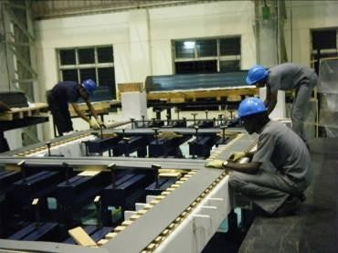

---
**WI-KCA-02#24  [Step 13]**  Step 13: Core duct placing. How: Provide the core duct after specified stack as per drawing. Measure distance as specified in drawing. After pasting the core duct, leave it for 20 minutes for drying & after that continue the stacking process. Why: For cooling purpose of the core

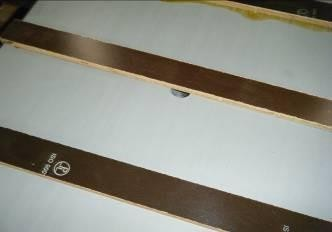

---
**WI-KCA-02#25  [Step 14]**  Step 14: . How: Continue the next step of. Why: To

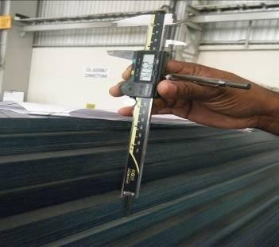

---
**WI-KCA-02#26  [Step 14]**  Step 14: . How: laminations and check the. Why: the

---
**WI-KCA-02#27  [Step 14]**  Step 14: . How: stack dimensions, horizontal level like this. Why: thickness

---
**WI-KCA-02#28  [Step 14]**  Step 14: . How: way stack all steps and. Why: as

---
**WI-KCA-02#29  [Step 14]**  Step 14: . How: check dimensions in each. Why: drawing

---
**WI-KCA-02#30  [Step 14]**  Step 14: Stack the. How: stack before proceeding to. Why: 

---
**WI-KCA-02#31  [Step 14]**  Step 14: next step. How: next stack. Verify that step 1. Why: 

---
**WI-KCA-02#32  [Step 14]**  Step 14: . How: is centered. Why: 

---
**WI-KCA-02#33  [Step 14]**  Step 14: . How: Tolerance should be±0.6. Why: 

---
**WI-KCA-02#34  [Step 14]**  Step 14: . How: mm. For stacking purpose. Why: 

---
**WI-KCA-02#35  [Step 14]**  Step 14: . How: check it. Why: 

---
**WI-KCA-02#36  [Step 14]**  Step 14: . How: sample Annexture-1. Check. Why: 

---
**WI-KCA-02#37  [Step 14]**  Step 14: . How: the diagonal squareness of. Why: 

---
**WI-KCA-02#38  [Step 14]**  Step 14: . How: all 5 limb before proceeding. Why: 

---
**WI-KCA-02#39  [Step 14]**  Step 14: . How: to next stack. Why: 

---
**WI-KCA-02#40  [text]**  OCP-WORK INSTRUCTION OF 5 LIMB CORE ASSEMBLY

---
**WI-KCA-02#41  [Step 15]**  Step 15: completion. How: After completing all the stack height with OD calipers and note down in the check list. Tolerance thickness should be ±2.0 mm after pressing. mm after pressing.. Why: To ensure the core diameter

---
**WI-KCA-02#42  [Step 16]**  Step 16: . How: Place core insulation and. Why: To provide

---
**WI-KCA-02#43  [Step 16]**  Step 16: insulation. How: flitch plate insulation on top. Why: Insulation.

---
**WI-KCA-02#44  [Step 16]**  Step 16: placing. How: of the core inappropriate. Why: 

---
**WI-KCA-02#45  [Step 16]**  Step 16: . How: places. Validate the frames. Why: 

---
**WI-KCA-02#46  [Step 16]**  Step 16: . How: and flitch plate above the. Why: 

---
**WI-KCA-02#47  [Step 16]**  Step 16: . How: Lower leveled. Hold. Why: 

---
**WI-KCA-02#48  [Step 16]**  Step 16: . How: lamination and insulation to. Why: 

---
**WI-KCA-02#49  [Step 16]**  Step 16: . How: prevent movement.. Why: 

---
**WI-KCA-02#50  [Step 17]**  Step 17: Frame tightening & stepwood gap. How: Provide all specified. Why: To tight the

---
**WI-KCA-02#51  [Step 17]**  Step 17: Frame tightening & stepwood gap. How: hardware, yoke studs and tie rods & tight them with spanners. Why: core

---
**WI-KCA-02#52  [Step 17]**  Step 17: Frame tightening & stepwood gap. How: Fill step wood to core gap by wooden or PCB material. Why: 

---
**WI-KCA-02#53  [Step 18]**  Step 18: channel fixing. How: . Why: To hold the

---
**WI-KCA-02#54  [Step 18]**  Step 18: channel fixing. How: the core and core fixture. Why: core intact

---
**WI-KCA-02#55  [Step 18]**  Step 18: channel fixing. How: and tight them to hold the. Why: while

---
**WI-KCA-02#56  [Step 18]**  Step 18: channel fixing. How: core intact while making it. Why: making it

---
**WI-KCA-02#57  [Step 18]**  Step 18: channel fixing. How: vertical. Why: vertical

---
**WI-KCA-02#58  [text]**  OCP- WORK INSTRUCTION OF 5 LIMB CORE ASSEMBLY

---
**WI-KCA-02#59  [Step 19]**  Step 19: Top yoke. How: After completion of all the. Why: To

---
**WI-KCA-02#60  [Step 19]**  Step 19: removal. How: stack start removing the. Why: core

---
**WI-KCA-02#61  [Step 19]**  Step 19: . How: lamination one be one. Keep the duct position. Why: vertical

---
**WI-KCA-02#62  [Step 19]**  Step 19: . How: same while removing the. Why: 

---
**WI-KCA-02#63  [Step 19]**  Step 19: . How: top yoke. Why: 

---
**WI-KCA-02#64  [Step 20]**  Step 20: Tightening. How: Tight the side limb by using. Why: To provide

---
**WI-KCA-02#65  [Step 20]**  Step 20: the side limb. How: Polyglass tape. For. Why: extra

---
**WI-KCA-02#66  [Step 20]**  Step 20: of core. How: preparation of polyglass. Why: tightening

---
**WI-KCA-02#67  [Step 20]**  Step 20: . How: tape follow the method P-. Why: of

---
**WI-KCA-02#68  [Step 20]**  Step 20: . How: KCA-005 Method for. Why: limb

---
**WI-KCA-02#69  [Step 20]**  Step 20: . How: Polyglass belt preparation. Why: core

---
**WI-KCA-02#70  [Step 20]**  Step 20: . How: and uses.. Why: 

---
**WI-KCA-02#71  [Step 21]**  Step 21: Core. How: Tight the core with green. Why: To

---
**WI-KCA-02#72  [Step 21]**  Step 21: tightening by. How: polyster. Why: maintain

---
**WI-KCA-02#73  [Step 21]**  Step 21: green. How: with strapping machine.. Why: the

---
**WI-KCA-02#74  [Step 21]**  Step 21: polyster. How: Follow the method to tight. Why: diameter of

---
**WI-KCA-02#75  [Step 21]**  Step 21: . How: the core P-KCA-004. Why: core and to

---
**WI-KCA-02#76  [Step 21]**  Step 21: . How: Method for polyester belt tight. Why: Increase the length

---
**WI-KCA-02#77  [Step 22]**  Step 22: Checking the hardware & painting. How: . Why: To ensure

---
**WI-KCA-02#78  [Step 22]**  Step 22: Checking the hardware & painting. How: Check all cross channels, base feet packing yoke studs correctness and tightness of hardware &. Why: core building is lifted safely with quality

---
**WI-KCA-02#79  [Step 22]**  Step 22: Checking the hardware & painting. How: painting. Why: 

---
**WI-KCA-02#80  [text]**  OCP-WORK INSTRUCTION OF 5 LIMB CORE ASSEMBLY

---
**WI-KCA-02#81  [text]**  23 | Place the step wood in appropriate core stick to maintain the core diameter. Strap the core using 2225 polyester strap-19mm width. Strapping belts will be maintained at every 150-200 mm gap for above 10MVA & below 10MVA glue apply the core using by dobefil

---
**WI-KCA-02#82  [text]**  24 | Fix the core uppender with bottom support of fixture. Tight all the nuts and bolts of up ender with fixture support. Apply the dobefil. | To keep it in Position.

---
**WI-KCA-02#83  [text]**  25 | Apply 2500volts to core & frame by meggar, If Isolation job apply 2500volts to frame to frame | To identify any short in core to frame& frame to frame

---
**WI-KCA-02#84  [text]**  26 | Make the core vertical along with the fixture and core up ender by using crane; fix the support of fixture with proper hardware. | To make vertical.

---
**WI-KCA-02#85  [text]**  27 | Provide the base support for the entire limb. Check the horizontal level of up ender with spirit level | To provide base support and to lift the core

---
**WI-KCA-02#86  [text]**  OCP-WORK INSTRUCTION OF 5 LIMB CORE ASSEMBLY

---
**WI-KCA-02#87  [Step 28]**  Step 28: Core building lifting. How: Place the D shackle in core frame lifting bollard and place the sling in D Shackle. Release all cross channels and extra support channels which are provided to provide core intact with the fixture. Loose the piston and remove the ratchet belt fixing from core with the fixture. Now move the core in next area.. Why: For lifting the core

---
**WI-KCA-02#88  [Step 29]**  Step 29: Core limb supporting arrangement. How: Core assembly is placed on channels and the supports connected from channels to top side of the limbs(below core frames) for supporting the limbs on both sides for all the three phases.. Why: To avoid fall of core which tends to damage for core

---
**WI-KCA-02#89  [Step 30]**  Step 30: Densified wood ring placing. How: Place the bottom densified wood ring in three limbs with the height specified in drawing.. Why: For leveling base.

---
**WI-KCA-02#90  [Step 31]**  Step 31: Fill the check list. How: Fill up the check list F-KCA- 007 at appropriate stage, job card F-KJC-001.. Why: To ensure the core assembly at each stage of process

---
**WI-KCA-02#91  [text]**  OCP-WORK INSTRUCTION OF 5 LIMB CORE ASSEMBLY REFERENCE: F-KCA-007 Check list of core building F-KJC-001Jobcard P-KCA-001 Method of Respect for the materials (Core) P-KCA-002 Quality product (Core) P-KCA-003 Daily work routine P-KCA-004 Method for polyester belt tightening P-KCA-005 Method of poly glass belt preparation anduses8. KZ-KCC-Core-2019-2020 9. Good & Bad –core-2019-2020 ANNEXURE-1 ANNEXURE-2

---
**WI-KCA-02#92  [text]**  Prepared by | Reviewed by | Approved by

---
**WI-KCA-02#93  [text]**  [NAME] Engineer-Operations | [NAME] Dy Manager - Operations | [NAME] Dy Manager - Quality | [NAME] Sr.Manager- Operations | [NAME] DGM- Quality

---
**WI-KCA-02#94  [text]**  ANNEXURE-1 ANNEXURE-2

---

# WI-KCA-03  (rev: MISSING)  -  WI-KCA-03 WORK INSTRUCTION FOR DOBEFILL APPLYING PROCESS.docx

**WI-KCA-03#1  [text]**  OCP-WORK INSTRUCTION FOR DOBEFILL APPLYING PROCESS SCOPE: This work instruction is based on the Dobefill applying process. OBJECTIVE: The objective of this work instruction is to establish the necessary activities to be performed while application of resin on core in PT and DT Jobs. It gives safety instructions too. PRE REQUISITES:

---
**WI-KCA-03#2  [text]**  PPEs: | SAFETY:

---
**WI-KCA-03#3  [text]**  Use all PPEs required for this stage Use correct tools Use gloves

---
**WI-KCA-03#4  [text]**  Operational Condition | Environmental Impact | Control

---
**WI-KCA-03#5  [text]**  Temperature : Normal Monitoring : Nil Health Risk : Moderate | Land Contamination. Resource Depletion. | Ensure that the cotton waste, Gloves, used brushes, and used containers are disposed to respective bins. Non-Hazardous/ Hazardous waste disposal as per waste management procedure Ref: [COMPANY]-IMSP-36

---
**WI-KCA-03#6  [text]**  TOOLS: | MATERIALS:

---
**WI-KCA-03#7  [text]**  Brush Measurement pot / Weighing scale Weighing Machine Measuring Cup | 1.Container for mixing 2.Resin (Dobefil 60) & Hardener 758 3.Core Clamping channels

---
**WI-KCA-03#8  [text]**  4. PROCEDURE:

---
**WI-KCA-03#9  [Step 1]**  Step 1: Cleaning the Core. How: Clean the limbs of the core with clean cotton waste on six sides of the core where the Dobefill is to be applied. Why: To remove any foreign particles on the core

---
**WI-KCA-03#10  [Step 2]**  Step 2: Measuring the weight of Container. How: Take a empty clean container and place it on the weighing scale. Why: To find the weight of the container and neglect it

---
**WI-KCA-03#11  [Step 3]**  Step 3: Measuring the weight of Dobefil (Dobefil 60). How: Stir well and pour the dobefill in the container around 2Kg. Why: To get the proper content of dobefill without having any solid blocks of dobefill

---
**WI-KCA-03#12  [Step 4]**  Step 4: Mixing Hardener in the Dobefil 60. How: The Mixture of dobefill and Hardener 758 should be mixed at the ratio of 100:5 at room temperature stir it well until it mixes well with dobefill. Why: To make homogenous mixture of Dobefill and Hardener

---
**WI-KCA-03#13  [Step 5]**  Step 5: Applying the solution on core. How: Cover the floor with polythene cover Provide a marking 100mm below the top yoke area (for free placement of top yoke) Apply solution on core edges by brush all around, except Top yoke. Why: For Dobefill process

---
**WI-KCA-03#14  [Step 6]**  Step 6: Area dobefill to be applied. How: The Dobefill should be applied on the side 100 mm below the top yoke till the bottom area of the core and it should be applied in between the phase limb also and top and bottom of bottom yoke. Why: 

---
**WI-KCA-03#15  [text]**  NOTE: Pot life of mixture is around 42 min at 25˚C, so apply before 30 min., After application of mixture keep core for 24 hrs for curing The Dobefill should be applied under clamped conditions (2 Clamps to be provided) This procedure is to be followed only for core up to 10MVA rating Lump shouldn’t be formed while applying dobefill & it must be even throughout the core While applying dobefill it shouldn’t run down at any places of the core.

---
**WI-KCA-03#16  [text]**  Prepared by | Reviewed by | Approved by

---
**WI-KCA-03#17  [text]**  [NAME] Engineer-Operations | [NAME] Dy Manager - Operations | [NAME] Dy Manager - Quality | [NAME] Sr.Manager- Operations | [NAME] DGM- Quality

---
